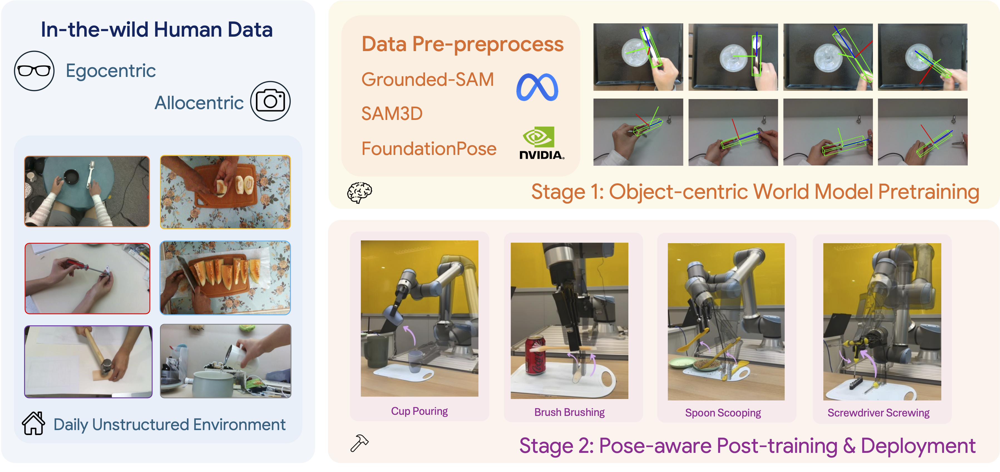

# 🛠️ P2P-T

### From Pixel to Poses: Object-centric Tool Manipulation Learning from Human Demonstrations

<p align="left">
  <a href="https://opendrivelab.com/P2P-T"></a>
  <a href="https://arxiv.org/abs/2609.35375"></a>
  <a href="mailto:contact@bangjunwang.com"></a>
</p>

<p align="center">
  
</p>

P2P-T learns precise tool manipulation from human demonstrations without
human-robot paired trajectories. It first learns future object-centric tool
pose latents from verified videos, then conditions an RDT diffusion action
expert on those latents for robot execution.

The repository is organized as a focused release around one supported
embodiment path: UR10e with an HDF5 robot dataset. Large datasets, foundation
model weights, and trained checkpoints are external artifacts recorded in
[`release_manifest.yaml`](release_manifest.yaml).

## 🗺️ Workflow and release checklist

1. **🎥 Preprocess human videos.** Grounded-SAM produces tool masks, SAM 3D
   reconstructs a mesh, and FoundationPose tracks camera-relative 4x4 poses.
   See [`preprocess/README.md`](preprocess/README.md).
2. **✅ Validate the Stage 1 corpus.**
   ```bash
   python3 -m preprocess.validate_stage1_dataset \
     data/stage1_data/parsed_taco_data --future-steps 8
   ```
3. **🧠 Pretrain the object-centric world model.**
   ```bash
   python3 stage1/train.py --config stage1/config/stage1.yaml
   ```
4. **🤖 Post-train the pose-aware action expert.** Set the Stage 1 checkpoint in
   `STAGE1_CHECKPOINT_PATH`, then run:
   ```bash
   ./train_stage2.sh
   ```
5. **🚀 Validate the release surface.**
   ```bash
   python3 scripts/validate_release.py --config configs/ur10e_p2p_t.yaml
   python3 -m compileall stage1 models preprocess scripts train
   ```

The complete artifact and deployment gate is in
[`RELEASE_CHECKLIST.md`](RELEASE_CHECKLIST.md). The checklist keeps future
Stage 1 preprocessing outputs, Stage 1 pretrained checkpoints, and Stage 2
post-trained checkpoints explicitly pending until their hashes and metadata are
available.

## ⚙️ What is implemented

- **Stage 1:** frozen DINOv2, SigLIP, and T5-base encoders; an autoregressive
  transformer predicts eight future pose latents and decoded 4x4 tool poses,
  with the auxiliary visual feature loss weighted by `0.01`.
- **Stage 2:** the Stage 1 world model is frozen. Each future pose latent is
  projected into the RDT hidden space and inserted before robot proprioception;
  only the RDT action expert and pose adaptor are trained.
- **Data:** the Stage 1 sequence contract and a UR10e HDF5 action dataset are
  included. The release dataset registry currently contains the hammer task;
  add new tasks only after adding their statistics and validation evidence.
- **Deployment:** `inference_server.py` provides the UR10e socket interface;
  it accepts current RGB history, language, proprioception, and current tool
  pose when Stage 1 conditioning is enabled.

Start the server with a published Stage 2 checkpoint:

```bash
python3 inference_server.py \
  --config_path configs/ur10e_p2p_t.yaml \
  --ckpt /path/to/stage2/checkpoint \
  --pretrained_vision_encoder_name_or_path google/siglip-so400m-patch14-384 \
  --pretrained_text_encoder_name_or_path google/t5-v1_1-xxl
```

See [`docs/p2p_t_implementation.md`](docs/p2p_t_implementation.md) for the
paper-to-code mapping and token layout.

## 💻 Installation

Use Python 3.10 with a CUDA-compatible PyTorch and install the pinned runtime
dependencies:

```bash
python3 -m pip install -r requirements.txt
```

Install PyTorch and torchvision using the command matching your CUDA version.
Download the frozen encoder revisions configured by the training command:

- `google/t5-v1_1-xxl`
- `google/siglip-so400m-patch14-384`
- `facebookresearch/dinov2` / `dinov2_vitb14_reg`

The release validator does not download weights, so it can run in a clean CI
environment before model artifacts are available.

## 🗂️ Dataset contracts

Stage 1 outputs use `task/seq_*` directories containing aligned `rgb/`,
`masks/`, `tool_mesh.obj`, `tool_poses.pkl`, and language/verification files.
Stage 2 robot episodes use one HDF5 file per episode under
`data/datasets/hammer/` by default. The HDF5 loader converts UR10e joint and
gripper values into the 128-dimensional unified state vector.

Do not commit raw videos, HDF5 episodes, generated logs, or model weights.
Record their external locations, revisions, and SHA256 values in the release
manifest.

## 📝 Citation and reference

```bibtex
@article{wang2026p2pt,
  title={From Pixel to Poses: Object-centric Tool Manipulation Learning from Human Demonstrations},
  author={Wang, Bangjun and Wu, Longyan and Wei, Yukun and Shao, Shenghe and Huang, Chaoyi and Cui, Wenze and Xu, Zetong and Wu, Hanlin and Chen, Long and Ma, Yi and Li, Hongyang},
  journal={arXiv preprint},
  year={2026}
}
```

## 📄 License

See [`LICENSE`](LICENSE). Upstream RDT components retain their original license
and attribution requirements.
